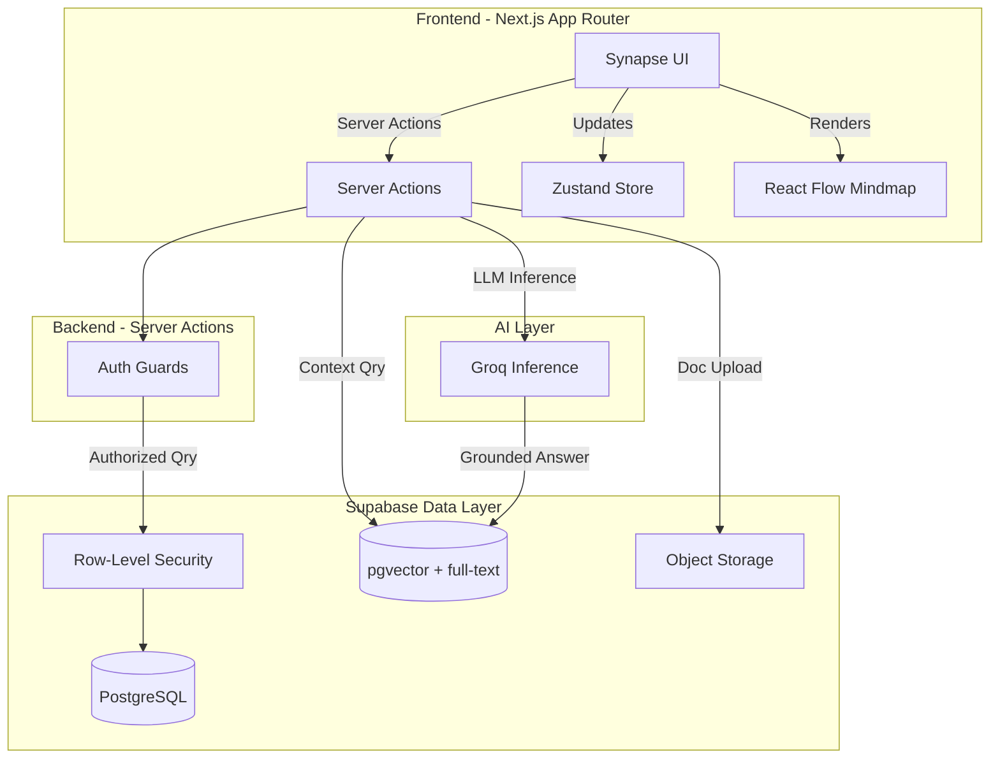

# Synapse 🧠

Synapse (formerly MindMapClass) is a multi-tenant academic progress platform. It answers one
question that a gradebook answers badly: *where is this class, and where is this student,
right now?* The curriculum is drawn as an interactive mindmap, and both the teacher's
delivery and each student's own progress are tracked against it.

## What is actually built

| Area | Status |
| --- | --- |
| Multi-tenant data model (institution → batch → subject → topic) | Built |
| Row-Level Security on every table, verified by a cross-tenant probe | Built |
| React Flow mindmap, teacher-built, student-pannable | Built |
| Dual progress: `TeacherProgress` + `StudentProgress` | Built |
| Node states: not started → upcoming → in progress → completed | Built (`upcoming` is derived) |
| Three-tier engagement bands (Progressing / Stuck / Inactive) | Built |
| Announcements, assignments + submissions, CSV onboarding | Built |
| Derived XP, levels and badges | Built |
| Subject-scoped RAG chat + PDF ingestion | Built, with the caveats below |
| Class progress report (print → PDF) | Built |
| Per-student heatmap painted onto the canvas | **Not built** |

## Local setup

```bash
cp .env.example .env.local          # Supabase URL, anon + service keys, DATABASE_URL, GROQ_API_KEY
npm install                         # runs prisma generate
npx prisma migrate deploy           # apply migrations 1..4
psql "$DATABASE_URL" -f scripts/setup-rls.sql
npm run seed                        # demo tenant with real Supabase auth users
npm run dev
```

Demo accounts created by the seed — password `SynapseDemo2026!`:

| account | role |
| --- | --- |
| `teacher@demo.synapse.dev` | TEACHER (1 batch, 8 topics, 10 students) |
| `student1@demo.synapse.dev` … `student10@` | STUDENT |
| `admin@demo.synapse.dev` | ADMIN + platform operator |

Checks: `npm run typecheck` · `npm run lint` · `npm test` · `npm run build` — all four run in CI.
`npm run test:rls` runs the tenant-isolation suite against a live database.

## Architecture



### How the pieces fit

1. **Onboarding.** A platform operator (`User.isSuperAdmin`) creates an institution at
   `/admin/institutions`. Teachers then onboard students either with a CSV paste
   (`/teacher/students`) or a batch join code. The join code is the one sanctioned
   cross-tenant read, implemented as a `SECURITY DEFINER` function.

2. **Curriculum.** A teacher creates a batch and subject, then lays the syllabus out on the
   mindmap canvas. Every node can carry resources and assignments.

3. **Progress.** `TeacherProgress` records what the class has been taught;
   `StudentProgress` records what each student has done. A node is *upcoming* when the
   teacher has opened it and that student has not started — the state is derived, not stored,
   so it can never contradict the two tables.

4. **Analytics.** Engagement events (logins, page views, resource views, AI chats, topic
   completions) are folded into three bands: Progressing, Stuck, Inactive. Teachers see the
   bands plus the list of topics the class has not started; `/teacher/report` prints the whole
   class as an A4 PDF.

## The RAG pipeline, honestly

PDFs are extracted, chunked at ~500 characters with overlap, and stored per subject in
`document_chunks`. Retrieval filters strictly on `subject_id`, so one subject's material can
never appear as context for another.

Two upstream changes shaped the current design:

- Groq retired its embedding models (`nvidia/nv-embedqa-e5-v5` reached end of life on
  2026-08-25), and the NVIDIA NIM account used here is not provisioned for embeddings.
- `llama-3.3-70b-versatile` is no longer served; chat runs on `openai/gpt-oss-120b`.

So the vector path is **opt-in**: set `EMBEDDING_BASE_URL`, `EMBEDDING_MODEL` and
`EMBEDDING_API_KEY` to use pgvector. Without them, retrieval falls back to PostgreSQL
full-text search (`websearch_to_tsquery`, GIN-indexed), which works today and keeps answers
grounded in the teacher's own material. `migrations/3_fts` adds that index.

## Tech stack

- **Framework:** Next.js 16 (App Router, Turbopack), React 19
- **UI:** Tailwind CSS v4, Framer Motion, Base UI components (`base-nova`), lucide icons
- **Data:** PostgreSQL, Prisma 7 with the `@prisma/adapter-pg` driver, pgvector
- **Auth & storage:** Supabase Auth (SSR), Supabase Storage
- **Canvas:** React Flow (`@xyflow/react` 12), Zustand for client state
- **AI:** Groq SDK for chat, PDF ingestion via `pdf-parse` v2

## Routes

```
/login                       sign in
/student                     dashboard
/student/learning-path       mindmap + assignments + announcements + XP
/student/subjects/[subjectId]
/teacher                     dashboard
/teacher/learning-path       class progress + announcements + assignment counts
/teacher/subjects/[subjectId]
/teacher/students            CSV onboarding
/teacher/assignments         create + track submissions
/teacher/report              printable class report
/teacher/analytics
/admin                       institution overview
/admin/institutions          tenant creation (platform operator only)
```

## Docs

- `docs/SUPABASE.md` — project setup, the role split, and the RLS evidence
- `docs/report/` — the corrected project proposal (28 pages) plus its change log
- `scripts/verify-rls.sql` — re-run the isolation probe per institution
